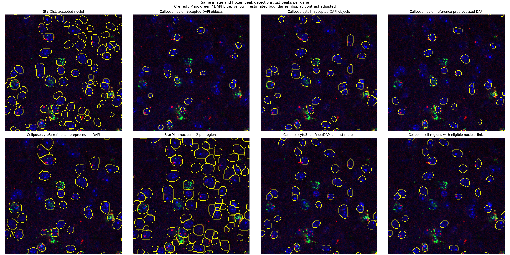

# Cellpose second opinion on the reference image

Cellpose was run on the same single-section `20X_L_CZI.czi`, with the original
**≥3 detected puncta for each gene**. StarDist was the production method when
this comparison was run; its settings remain unchanged. No method was selected by its coexpression percentage.

The runs show substantial segmentation disagreement. The Pnoc-guided estimates
do **not yet support replacing the 2 µm counting region with validated whole-cell
boundaries** on this image. Expert annotations have not been supplied; a blinded
review package is prepared so the differences can be assessed independently.

## Runs and controlled quantities

- Cellpose **3.1.1.3**, using its requested legacy `nuclei` and `cyto3` models,
  with PyTorch 2.7.1 CPU. These are distinct from newer Cellpose-SAM models.
- An isolated `.venv-cellpose` uses NumPy 2.0.2, required by this Cellpose release.
  The StarDist environment and its dependency pins are preserved.
- `nuclei`: DAPI alone, diameter 17 pixels. `cyto3`: DAPI alone at 17 pixels as
  a nuclear-object comparison, and Pnoc as the primary channel with DAPI as the
  auxiliary nuclear channel at 30 pixels for candidate cell outlines.
- Diameters were fixed without using the overlap result: the reference median
  nuclear equivalent diameter is 16.55 pixels; 17 is also the pretrained nuclear
  scale. Thirty pixels is the standard cytoplasmic-model scale. At this image's
  sampling these correspond to 11.74 and 20.72 µm. These choices are not an
  exhaustive diameter/flow-threshold optimization.
- Raw inputs use Cellpose's independent per-channel 1st/99th-percentile
  normalization. Additional DAPI controls apply the same 1.4 µm smoothing,
  1st/99.8th-percentile normalization and CLAHE as StarDist before Cellpose's
  own normalization. These controls are reported separately, including failures
  to improve candidate coverage.
- Flow threshold 0.4, cell-probability threshold 0, minimum mask size 15 pixels,
  resampling enabled, no test-time augmentation, two CPU threads.
- Nuclear acceptance uses the same 20–300 µm² size range, border exclusion and
  DAPI-contrast criterion as the StarDist profile. Cell outlines do not inherit
  the nuclear upper-area cutoff.
- **All 1,209 Cre and 3,531 Pnoc detected peak coordinates are frozen** from the
  reference export. No peak threshold, saturation substitution or positivity
  criterion is changed. Each nuclear model is evaluated with no expansion and
  with the same non-overlapping 2 µm expansion, blocking rejected nuclei.

The default legacy model-download route returned HTTP 500. The same official
server's `https://www.cellpose.org/static/models/` route supplied the named
weight files over normally verified HTTPS. Local SHA-256 fingerprints are
recorded for reproducibility, rather than represented as an independently
published checksum:

| Weight file | SHA-256 |
|---|---|
| `nucleitorch_0` | `89ca45e4a45048d5010d29621466b1274b91b3dcb9714dce9f9e90a9a8671303` |
| `cyto3` | `2dc3087a8abd7da46d1ab0ddd5824639933cc3ff63b382af3fa1939a392db93c` |

## Reference results

The nuclear-method rows below all use **nucleus +2 µm**, ≥3 peaks per gene.
The last row uses eligible Cellpose cell-region estimates instead of expansion
and has different coverage; its denominator is not the baseline population.

| Method | Raw candidates | Accepted/eligible objects | Cre-positive | Double-positive | Double / Cre |
|---|---:|---:|---:|---:|---:|
| StarDist (production profile at the time) | 1,770 | 1,554 | 121 | 109 | **90.08%** |
| Cellpose `nuclei`, raw DAPI | 436 | 409 | 38 | 36 | 94.74% |
| Cellpose `cyto3`, raw DAPI | 1,123 | 1,032 | 100 | 88 | 88.00% |
| Cellpose `nuclei`, reference-preprocessed DAPI | 816 | 756 | 55 | 49 | 89.09% |
| Cellpose `cyto3`, reference-preprocessed DAPI | 535 | 421 | 60 | 53 | 88.33% |
| Cellpose `cyto3`, Pnoc + DAPI cell estimates | 435 | 335 linked regions | 14 | 11 | 78.57% |

The `nuclei` raw-DAPI result exceeds 94% while retaining a much smaller detected
Cre-positive group. That does not establish improved sensitivity or accuracy.
Fewer Cellpose objects could reflect missed nuclei, differences in boundaries,
or StarDist over-segmentation; object-level expert review is needed to separate
these possibilities. A model is not ground truth for another model.

At one-to-one nuclear IoU ≥0.5, matched objects against the 1,554 accepted
StarDist nuclei are 124 (`nuclei` raw), 737 (`cyto3` raw), 412 (`nuclei`
preprocessed), and 308 (`cyto3` preprocessed). Among those matched pairs, the
2 µm expression class changes in 10, 50, 28 and 29 pairs, respectively.
These are **method-agreement** statistics, not expert-annotation precision,
recall or sensitivity estimates. The complete [count table](reference_cellpose_comparison.csv),
[agreement statistics](reference_cellpose_nuclear_agreement.json) and
[cell-region coverage](reference_cellpose_cell_region_coverage.json) are saved.



The same fixed crop is shown for each method. In this example, several
Pnoc/DAPI-guided outlines remain close to nuclei. Punctate RNA does not provide
a continuous membrane/cytoplasmic boundary, and using the target gene to guide
its own counting region can introduce selection bias. Cy3's biological probe
identity is unspecified; it is retained for review and is **not assumed to be
an autofluorescence or cell-boundary marker**.

## Cell-outline coverage and ambiguous cases

Each candidate cell outline is checked against **all** StarDist candidate
nuclei, including rejected objects. An eligible link requires:

1. Exactly one candidate nucleus with ≥50% of its nuclear area inside that cell.
2. That nucleus passes the reference acceptance filters.
3. The cell does not touch the image border and no other eligible cell claims
   the same nucleus. Exact half-nucleus ties are treated as ambiguous.

Pixels inside other candidate nuclei are blocked from a linked cell's counting
region. The 50% rule is a declared linking heuristic, not validated cell identity.
Minor overlap with other nuclei is recorded for review. Candidate outcomes were
335 eligible, 49 with multiple nuclear occupants, 45 without a majority-covered
nucleus and six linked only to a rejected reference nucleus.

Only **20/121 baseline Cre-positive objects** have an eligible cell outline;
15/20 have ≥3 Pnoc peaks in that region. The other **101 are unknown**, not
Pnoc-negative. With that much missing coverage, this subset cannot replace the
original 109/121 endpoint. The full 121-object Pnoc fraction could range from
15/121 to 116/121 depending on the unknown cases, even before segmentation error
is considered. The separate 11/14 result also reclassifies Cre within the cell
estimates and must not be presented as the original cohort's percentage.

## Blinded review package

The runtime output contains a `blinded_review` folder with:

- Eight spatial tiles selected using a fixed random seed without RNA-class
  selection: four calibration and four held-out tiles, each with 32-pixel context.
- Original 16-bit four-channel TIFFs with µm calibration, raw-image previews,
  and tile/core coordinates in the full reference image.
- Randomized prediction codes with separate nuclear and region-boundary tasks:
  five nuclear variants, the 2 µm reference, raw Cellpose cell estimates and
  eligible linked-cell estimates. There are **64 coded reviews**.
- Empty full-image label/ROI templates and a score sheet for missed/false
  objects, splits/merges, boundary agreement, and boundaries that are not visible.

Researchers should annotate **raw images first**, before seeing predictions.
Zero-filled template TIFFs are not completed annotations. Cell boundaries should
be marked uncertain when the image cannot establish them. The blinding key
and all numerical method results are kept outside the reviewer folder and
excluded from the reviewer ZIP. Distinctive outlines may still make methods
recognizable, so blinding is not guaranteed. Tile holdout within one section is
not independent validation across sections/animals; use such samples for any
future training/generalization claim.

No object-level accuracy comparison has been performed because annotations do
not yet exist. Completed nuclear/cell instance masks, reviewed ROI and reviewer
IDs are needed before that comparison can be made. Keep ≥3 puncta and the
profile fixed while assessing these results.

## Reproduce the comparison

Keep the main analysis `.venv` for CZI export and comparison. Install Cellpose in
its own environment (tested on Linux CPU/Python 3.12):

```bash
python3 -m venv .venv-cellpose
.venv-cellpose/bin/python -m pip install -r requirements-cellpose.txt

.venv/bin/python prepare_cellpose_input.py \
  --czi /path/to/20X_L_CZI.czi \
  --reference results_expanded/images/20X_L_CZI.czi/scene_0 \
  --output results_cellpose

.venv-cellpose/bin/python cellpose_infer.py \
  --input results_cellpose/input_channels.npz \
  --metadata results_cellpose/input_metadata.json \
  --output results_cellpose/inference --preprocessing-control

.venv/bin/python compare_cellpose.py \
  --reference results_expanded/images/20X_L_CZI.czi/scene_0 \
  --input results_cellpose/input_channels.npz \
  --inference results_cellpose/inference \
  --output results_cellpose/comparison
```

Use new/empty output folders. Source CZI/config hashes are checked, input hashes
must agree with inference, mask hashes are verified, and frozen baseline counts
must reproduce. Native uint32 and µm-calibrated ImageJ masks, per-object counts,
one-to-one nuclear matches, changed expression calls, cell-link reasons and
manifests are exported. Source CZI images, model weights and generated reviewer
packages are not distributed in the Git repository. This optional workflow
currently requires square XY sampling and a single optical section.

The unit suite covers channel ordering, one-to-one matching under
splits/merges, sparse IDs, filtered masks, ambiguous cell links, run-root
discovery for nested scene folders, the csbdeep-free preprocessing control and
blinded package separation. Actual CPU inference on this reference image was run for
all five Cellpose variants. Passing tests establish software behavior, not
biological accuracy.
