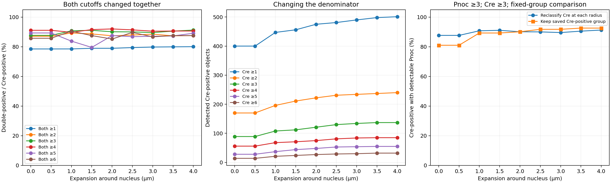
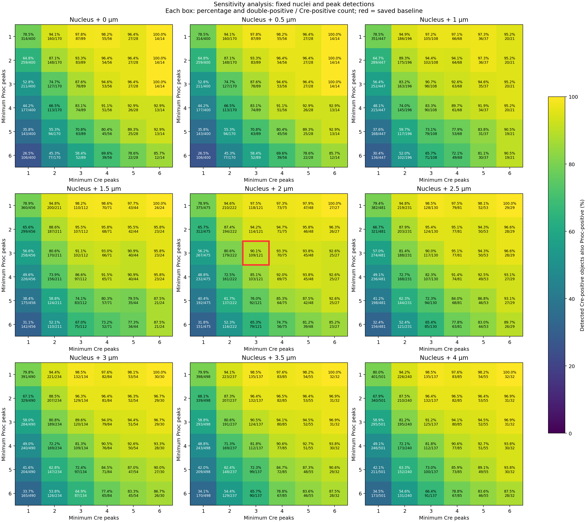

# Parameter sensitivity on the reference image

Higher percentages are possible, but the highest percentage is not an accuracy
optimum. This sweep changes the RNA-positivity cutoffs and assignment radius
while keeping DAPI segmentation and detected peak locations fixed. The shipped
profiles remain unchanged.

## What was tested

The single-section `20X_L_CZI.czi` reference image has 1,554 accepted nuclei.
The complete v0.2.3 expanded run was reused. No new peak detection, intensity
threshold adjustment, saturated-area count inference or nuclear inference was
performed. Baseline reassignment reproduces every accepted object's original
peak counts and all baseline summary counts before the sweep proceeds.

- Expansion: 0, 0.5, 1, 1.5, 2, 2.5, 3, 3.5 and 4 µm, applied to both genes.
- Pnoc positivity: independently ≥1 through ≥6 peaks.
- Cre positivity: independently ≥1 through ≥6 peaks.
- Total: **324 settings** on one reference section, with the same accepted masks.

The nearest-nucleus, non-overlapping assignment and rejected-mask blocking are
the same as in production. Increasing radius does not change the DAPI boundary;
it expands the surrounding counting region. Radii are sampled on the native
pixel grid (0.6905 µm/pixel here), explaining identical 0/0.5 µm results.

The main endpoint always uses the currently selected Cre-positive denominator.
A second endpoint holds the original **121 Cre-positive objects** at the saved
2 µm / ≥3 Cre baseline fixed and varies only their Pnoc calls. That comparison
is exploratory; separate per-gene radii are not a shipped production setting.

## Direct comparisons

All thresholds below mean "at least" the listed number of detected peaks.

| Expansion | Pnoc cutoff | Cre cutoff | Pnoc-positive | Cre-positive | Double-positive | Double / Cre |
|---|---:|---:|---:|---:|---:|---:|
| 2 µm, saved baseline | 3 | 3 | 371 | 121 | 109 | **90.08%** |
| 2 µm | 2 | 2 | 498 | 222 | 194 | 87.39% |
| 2 µm | 1 | 1 | 780 | 475 | 375 | 78.95% |
| 2 µm | 4 | 4 | 291 | 75 | 69 | 92.00% |
| 2 µm | 2 | 3 | 498 | 121 | 114 | **94.21%** |
| 2 µm | 1 | 3 | 780 | 121 | 118 | 97.52% |
| 2 µm | 3 | 4 | 371 | 75 | 70 | 93.33% |
| 3 µm | 3 | 3 | 395 | 134 | 120 | 89.55% |
| 3 µm | 2 | 3 | 529 | 134 | 129 | 96.27% |
| 4 µm | 3 | 3 | 408 | 137 | 125 | 91.24% |

Lowering **only Pnoc** increases this conditional fraction with the same Cre
group. Raising **only Cre** can raise the fraction by selecting a smaller,
stronger-signal group: the ≥4 Cre example loses 46/121 (38.0%) baseline
Cre-positive objects. Increasing both cutoffs to four has competing numerator
and denominator effects. Lowering both to two or one brings many additional
Cre-positive calls into the denominator and lowers the observed fraction here.

Expanding both genes to 3 µm also changes the denominator. Within the original
121 Cre-positive objects, Pnoc ≥3 increases from 109 to 111 (91.74%). There are
13 newly Cre-positive objects, nine of which meet Pnoc ≥3, giving the combined
120/134 (89.55%). Expansion to 4 µm gives 112/121 (92.56%) within the original
group. Larger regions can include neighboring cytoplasm or processes; these
additional assignments are not proof of correct cell ownership.

The full sweep reaches 100% in selected settings. For example, nucleus-only,
Pnoc ≥1 / Cre ≥6 gives 14/14, retaining just 14 of the original 121 Cre-positive
objects. This is a descriptive maximum, not a recommended optimum.





Every heatmap box shows both the percentage and double-positive / Cre-positive
counts. The red outline marks the saved baseline. The [full reference CSV](reference_parameter_sweep.csv)
includes both conditional directions, fixed-group results, changed Cre-group
membership and assigned area.

## Candidate to validate

**Pnoc ≥2 / Cre ≥3 at 2 µm** is a useful candidate for manual validation because
it preserves the baseline Cre group and changes just five of its Pnoc calls:
IDs **49, 295, 510, 946 and 970**, each with two assigned Pnoc peaks. All five
have bright-cluster review flags; ID 946 also has Pnoc saturation. These flags
identify review conditions and do not establish whether the calls are right.
The runtime sweep folder includes a five-object CSV and channel-by-channel
PNG/PDF review for this reference comparison. IDs match the baseline overlays.

The data do not establish that two is more accurate than three, or that any
radius is optimal. A defensible selection needs matched negative-control fields
and blinded per-object annotations on representative sections, followed by a
held-out comparison. Evaluate Pnoc detection within a predefined Cre group and
also check Cre-group membership. Fix the chosen settings before cohort analysis.
Approximate aggregate manual counts near 90% do not supply those object labels.

Until that comparison exists, retain the current production profile. The sweep
provides sensitivity estimates and concrete cases to inspect, rather than a
setting selected to maximize the expected percentage. One section does not
establish between-animal reproducibility or biological sensitivity/specificity.

## Reproduce on any complete analysis run

```bash
python sweep_parameters.py --results results_expanded --output results_sweep
```

Choose a new or empty output directory. The defaults reproduce the grid above.
For a custom grid:

```bash
python sweep_parameters.py --results results_expanded --output results_sweep_custom \
  --radii 0 1 2 3 4 --cutoffs 1 2 3 4
```

Outputs are `sweep.csv` (summed counts and count-weighted percentages),
`per_scene_sweep.csv`, `counts_by_nucleus.csv`, PNG/PDF heatmaps and radius plots,
and `sweep_manifest.json` with source-export hashes, baseline counts and versions.
Baseline-group columns deliberately ignore the swept Cre cutoff and retain the
saved group's membership. Failed/incomplete source runs and non-reproducing
baseline counts are rejected. No settings file or source image is modified.
The reference-specific five-object review is an additional exported artifact,
not a general output of the sweep CLI. Source CZI images are not distributed.
